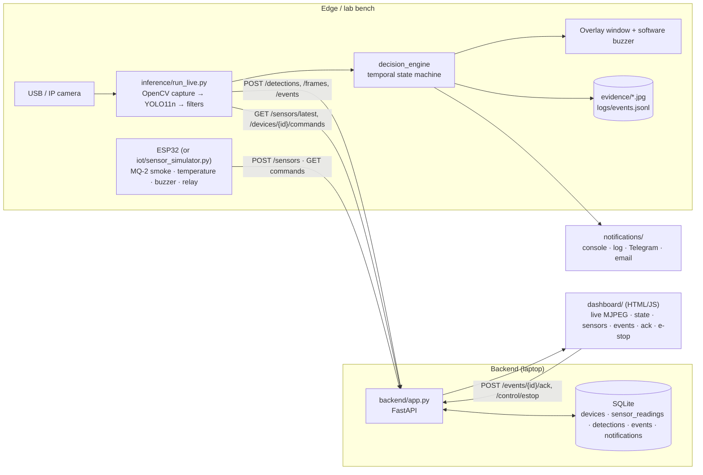
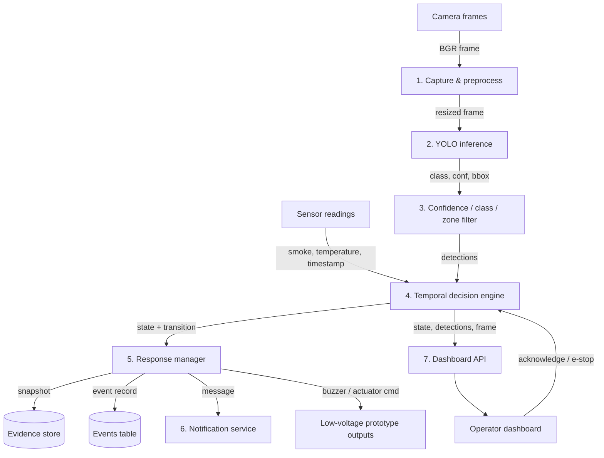
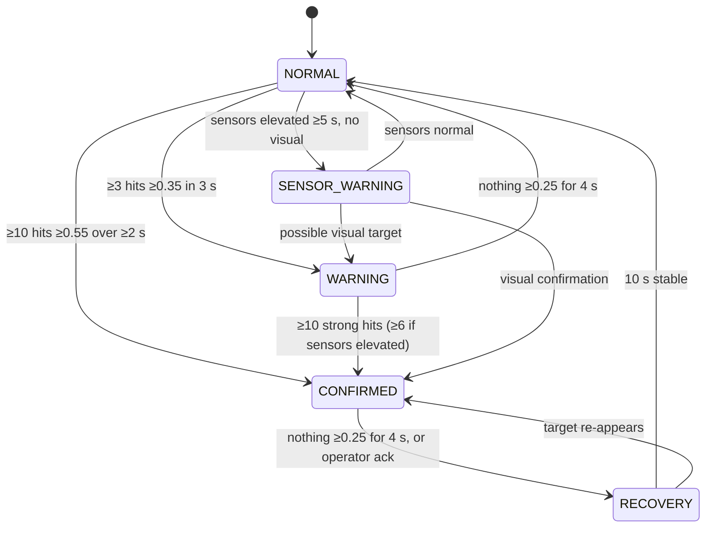
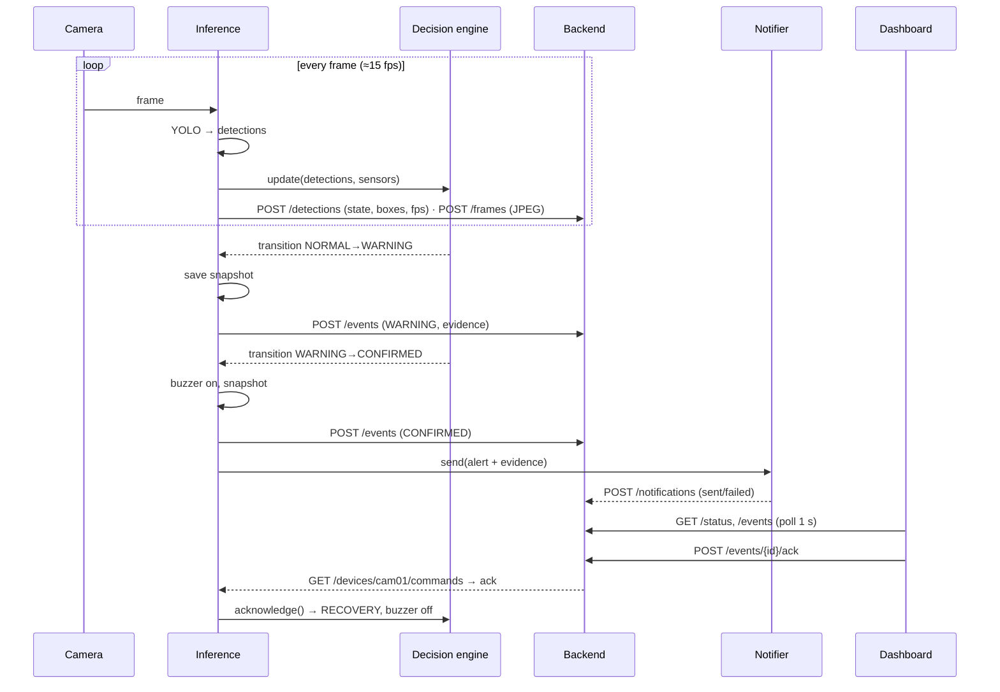

# Architecture and Data Flow

## System architecture

## Level-1 data-flow diagram

## Decision-engine state machine

## Sequence: confirmed fire event

## Module boundaries

| Folder | Responsibility | Depends on |
|---|---|---|
| `training/` | dataset build, training, evaluation | ultralytics, dataset zips |
| `vision/` | camera abstraction, overlay drawing | OpenCV |
| `decision_engine/` | pure temporal logic, no I/O | — |
| `inference/` | orchestrates camera → model → engine → outputs | all of the above |
| `notifications/` | channel adapters | requests, smtplib |
| `backend/` | REST API + SQLite + MJPEG | FastAPI |
| `dashboard/` | operator UI, static files | backend API |
| `iot/` | ESP32 firmware and its software simulator | backend API |
| `configs/` | all tunables; no code | — |
